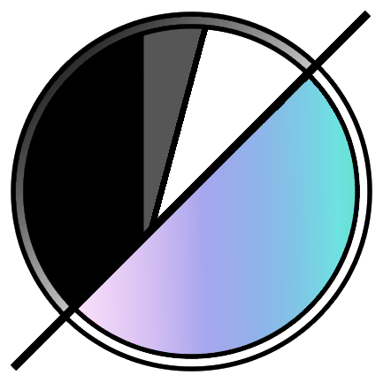

# EFAS Negative Inversion Software

**Bring your film negatives to life.**

A free, open-source film-negative converter for your desktop. 
From a single scan to a whole roll: invert, grade, repair, organise and export, all locally and non-destructively.

&nbsp;
&nbsp;

[**Download for Windows →**](../../releases) &nbsp;·&nbsp; [**Run from source →**](OLD_README.md#get-started)

[Features](OLD_README.md#features) · [Presets](OLD_README.md#presets) · [Plugins](OLD_README.md#plugins) · [Get started](OLD_README.md#get-started) · [Your data](OLD_README.md#where-your-data-lives) · [Privacy](OLD_README.md#privacy) · [Docs](OLD_README.md#documentation)

[Old AI SLOP Page](OLD_README.md)

---

I wanted to change the description of EFAS to better depict why I thought of it, why I "made" some aspects of it, why I used AI to clean up code and the UI.

Recently, I had a thought about analog and photography as a whole. I made EFAS because I wanted all the tools I used to be in a single place and have the best aspects of other software packed into one. I always found the aspect of switching between software, or each piece of software having really good aspects and things I like, and wanted to pack it into one thing. Therefore, I wanted to type an honest description for what EFAS is. 

EFAS combines multiple open source software capabilities into one thing, fully credited, and I make 0 profit off this, and don't plan to ever take donations or support. Most people who use AI to make software do claim to make everything, I don't. Some of the things I have added are based off peoples real research and software. I myself am currently doing real research into LUTs, Density Curves, H&D and more to try improve the software. That's not to say some AI isn't involved with EFAS, it is, it's helped me to implement stuff.

My intention with EFAS is a purely free, open source, non-profit editing app with real logic and research behind it. There are some aspects that were made with AI, sure. And code correction is undeniably done with AI, but I'm trying to put real logic in it, with not just typing in an artificial prompt and saying, "I made this guys!!!" It also involves real tools, from real people. Such as DarkTable, NegPy, Lightcraft and real color theory from dyes and negatives that I've done research on. 

Analog is supposed to be a pure process of creativity, untainted and untarnished from unrealistic editing and superficiality in photography, to depict something not realistically captured, to show ones pure creative perspective of the world. I just wanted software to all be in place. Please check out DarkTable, donate to them, check out Negpy, and check out everyone linked below!

## Everyone linked

Every project, article and paper EFAS has used, learned from or been built on, with where to find it and where to support the people behind it. A **—** in the last column means no donation page was found; the project page is still worth a visit. Nothing here is sponsored, and EFAS earns nothing from any of these links.

| Source | What EFAS took from it | Link | Support them |
|---|---|---|---|
| **darktable** | The interface and module layout, module presets and reset buttons, focus peaking, the drawn masks and the Retouch module, and the **Diffuse or Sharpen**, **Tone Equalizer** and **Color Balance RGB** modules (by Aurelien Pierre and the darktable developers), all ported from its design and source (GPL-3.0) | [darktable.org](https://www.darktable.org), [GitHub](https://github.com/darktable-org/darktable) | darktable has no official donation page. Its website is hosted by PIXLS.US, which takes support: [pixls.us/support](https://pixls.us/support/). The darktable team also has a small [Liberapay](https://liberapay.com/darktable/) |
| **NegPy** | The negative inversion and metering approach, dust and scratch repair, local contrast (CLAHE), the clone tool, the Snap / Toe / Shoulder response and its darkroom paper profiles (as the Papers (NegPy) presets), the print-stage approach behind the NegPy Conversion, and the sixteen film crosstalk profiles it bundles (GPL-3.0; parts of EFAS are adapted from its code) | [github.com/marcinz606/NegPy](https://github.com/marcinz606/NegPy) | [Ko-fi](https://ko-fi.com/marcinzawalski) |
| **noritsu-tool** (noritsu-tool contributors) | The Noritsu look conversion: density-space inversion with Dmin from the rebate, the LS-600's tone curve, three per-stock profiles fitted to real LS-600 prints and the thin / normal / dense settings suggestion (MIT; ported to numpy, its profile files are included with its licence) | [github.com/rohanpandula/noritsu-tool](https://github.com/rohanpandula/noritsu-tool) | — |
| **DarkSlide** | Roll-wide same-size crops, previewing a profile on hover, scanning-light settings, and its 78 film profiles and five lab styles as presets (MIT) | [github.com/kilianvivien/DarkSlide](https://github.com/kilianvivien/DarkSlide) | — |
| **Canon EDSDK Film Scanner** (Rafat Hossain) | The approach of Canon tethering: a camera thread that owns the SDK, live pictures converted on the computer, a sharpness meter, a settle time before the shutter (MIT; no code was copied) | [github.com/RafatH0ssain/Canon-EDSDK-Film-Scanner](https://github.com/RafatH0ssain/Canon-EDSDK-Film-Scanner) | — |
| **lightdrift** (David Esquivel) | The method behind Check My Scanning Light: measuring a scanning light's brightness, colour and evenness from raw sensor values (MIT; re-written as EFAS's own code) | [github.com/davidesqalv/lightdrift](https://github.com/davidesqalv/lightdrift) | — |
| **Pakon F-X35 scanner reference** | An outside check on the NegPy Conversion's density step: how the Pakon scanners turn a colour negative into a positive (documentation, CC BY 4.0; nothing copied) | [github.com/alibosworth/pakon-reference](https://github.com/alibosworth/pakon-reference) | — |
| **darktable AI models, Segment Anything 2.1 (Meta)** | The AI object mask: darktable's models and steps (the encoder reads the picture, the decoder turns clicks into a cut), downloaded on request from darktable's model repository and run on your computer. The weights are Apache-2.0; the pictures they were trained on are research-only | [github.com/darktable-org/darktable-ai](https://github.com/darktable-org/darktable-ai), [github.com/facebookresearch/sam2](https://github.com/facebookresearch/sam2) | see darktable above |
| **Lensfun** | The lens database behind the lens corrections: colour fringes, vignetting and distortion from a lens's name, focal length and aperture (library LGPL-3, database CC BY-SA 3.0) | [lensfun.github.io](https://lensfun.github.io), [GitHub](https://github.com/lensfun/lensfun) | No donation page. You can help by [contributing lens calibration data](https://discuss.pixls.us/t/create-lens-calibration-data-for-lensfun/9848) |
| **lensfunpy** (Maik Riechert) | The Python link to Lensfun (MIT) | [github.com/letmaik/lensfunpy](https://github.com/letmaik/lensfunpy) | — |
| **Lucide** | All the panel and tool-rail icons, as plain SVG files (ISC licence) | [lucide.dev](https://lucide.dev) | [Open Collective](https://opencollective.com/lucide-icons), [GitHub Sponsors](https://github.com/sponsors/lucide-icons) |
| **FilmDefectNet** | The small ONNX model behind AI dust detection: a tiny U-Net that finds dust, hairs and scratches in a scan. Made by Ethan; not published yet | — | — |
| **Adobe Lightroom** | Culling with flags and stars, presets, histogram and clipping views, contact sheets | [adobe.com/products/photoshop-lightroom](https://www.adobe.com/products/photoshop-lightroom.html) | — (a paid product) |
| **CineStill CS Negative+ Convert Tools** | The idea of a fast, accurate film-scan conversion workflow | [cinestillfilm.com](https://cinestillfilm.com), [PetaPixel write-up](https://petapixel.com/2025/07/01/cinestills-new-film-scan-conversion-software-is-fast-accurate-and-free) | — |
| **Lomography** | The photos behind the Film Colour Reference, to judge a conversion's colour against a film stock | [lomography.com](https://www.lomography.com) | — |
| **RawPedia: film negative** (RawTherapee) | Its power-law model of a film negative, studied and compared for the inversion design | [rawpedia.pixls.us/film_negative](https://rawpedia.pixls.us/film_negative/) | — |
| **darktable's negadoctor manual** | The module reference for darktable's negative inversion, studied for the inversion design | [docs.darktable.org](https://docs.darktable.org/usermanual/5.0/en/module-reference/processing-modules/negadoctor/) | see darktable above |
| **Sebastian Schlüter: The magic Fuji Frontier SP-3000** | Lab-look research: how a Frontier scanner renders a negative | [sebastian-schlueter.com](https://www.sebastian-schlueter.com/blog/2018/3/7/the-magic-fuji-frontier-sp-3000) | — |
| **Optik Oldschool: why we prefer Frontier scans** | Lab-look research: why Frontier and Noritsu scans look different | [optik-oldschool.com](https://www.optik-oldschool.com/blogs/blog/why-we-prefer-frontier-scans-for-opticolour200) | — |
| **The Find Lab: Noritsu vs Frontier** | Lab-look research: the two lab scanners' looks compared | [thefindlab.com](https://thefindlab.com/2015/02/23/noritsu-vs-frontier/) | — |
| **Carmencita Film Lab: Frontier vs Noritsu, round 2** | Lab-look research: the two lab scanners' looks compared | [carmencitafilmlab.com](https://carmencitafilmlab.com/blog/frontier-vs-noritsu-round-2/) | — |
| **J. B. Flanc: The art of film scanning, Frontier vs. Noritsu** | Lab-look research: the two lab scanners' looks compared | [jbflanc.substack.com](https://jbflanc.substack.com/p/the-art-of-film-scanning-frontier) | — |
| **Fuji X Weekly: Fujifilm Frontier scanners and dynamic range priority** | Lab-look research: how Frontier scanners handle dynamic range | [fujixweekly.com](https://fujixweekly.com/2021/09/12/fujifilm-frontier-scanners-dynamic-range-priority/) | — |
| **Harman Photo: recommended scanning parameters, Phoenix 200** (Oct 2024) | Lab-look research: the maker's own advice on how to scan a film stock | [harmanphoto.co.uk (PDF)](https://harmanphoto.co.uk/wp/wp-content/uploads/sites/3/2024/10/Phoenix-Scanning-Parameters-011024.pdf) | — |
| **Fujifilm: Image Intelligence** (ICIS 2006 paper, imaging.org) | Lab-look research: how Fujifilm's scanners process an image | [imaging.org (PDF)](https://www.imaging.org/common/uploaded%20files/pdfs/Papers/2006/ICIS-0-736/33740.pdf) | — |
| **Crété et al., "The Blur Effect"** | The re-blur test behind Grade Sharpness | [doi.org/10.1117/12.702790](https://doi.org/10.1117/12.702790) | — |
| **He et al., "Guided Image Filtering"** | The guided filter behind a mask's edge-aware feathering | [doi.org/10.1109/TPAMI.2012.213](https://doi.org/10.1109/TPAMI.2012.213) | — |
| **PyQt6** (Riverbank Computing) | The whole user interface toolkit | [pypi.org/project/PyQt6](https://pypi.org/project/PyQt6/) | — (a commercial licence is sold: [riverbankcomputing.com](https://www.riverbankcomputing.com/commercial/buy)) |
| **Pillow** | Reading and writing pictures | [python-pillow.org](https://python-pillow.org) | [GitHub Sponsors](https://github.com/sponsors/python-pillow), [Tidelift](https://tidelift.com/subscription/pkg/pypi-pillow) |
| **rawpy** (Maik Riechert) | Reading RAW files, through LibRaw | [github.com/letmaik/rawpy](https://github.com/letmaik/rawpy), [libraw.org](https://libraw.org) | — |
| **NumPy** | All the picture maths | [numpy.org](https://numpy.org) | [NumFOCUS](https://numfocus.org/donate-to-numpy) |
| **OpenCV** | Resizing, remapping, filtering and the repair tools | [opencv.org](https://opencv.org) | [GitHub Sponsors](https://github.com/sponsors/opencv) |
| **ONNX Runtime** | Running the AI dust model | [onnxruntime.ai](https://onnxruntime.ai) | — |
| **Lupa** (Stefan Behnel) | Lua scripting for plugins | [github.com/scoder/lupa](https://github.com/scoder/lupa) | [GitHub Sponsors](https://github.com/sponsors/scoder) |
| **wgpu-py** | GPU processing | [github.com/pygfx/wgpu-py](https://github.com/pygfx/wgpu-py) | [GitHub Sponsors](https://github.com/sponsors/pygfx) |
| **piexif** | Reading and writing EXIF | [github.com/hMatoba/Piexif](https://github.com/hMatoba/Piexif) | — |
| **tifffile** (Christoph Gohlke) | Reading and writing TIFF files | [github.com/cgohlke/tifffile](https://github.com/cgohlke/tifffile) | — |
| **Send2Trash** | Moving files to the recycle bin | [github.com/arsenetar/send2trash](https://github.com/arsenetar/send2trash) | [GitHub Sponsors](https://github.com/sponsors/arsenetar) |
| **FFmpeg** | Making slideshow videos | [ffmpeg.org](https://ffmpeg.org) | [ffmpeg.org/donations](https://ffmpeg.org/donations.html) |
| **PyTorch** | Training the dust detection model (not needed to run EFAS) | [pytorch.org](https://pytorch.org) | — |
| **Python** | Everything | [python.org](https://www.python.org) | [Python Software Foundation](https://www.python.org/psf/donations/) |
